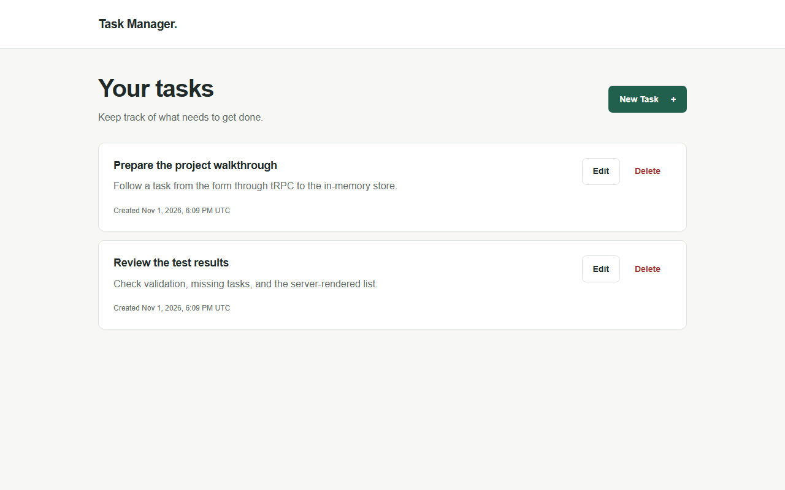

# Task Manager

A minimal task management application for the Artefact Software Engineer technical case, built with Next.js 15, React, TypeScript, and tRPC.

## Features

- Create, list, edit, and delete tasks through tRPC.
- Server-rendered first page, with task data stored only in server memory.
- Infinite scroll with ten tasks per page, error retry, and a keyboard-accessible Load More button.
- Shared create/edit form with validation, pending states, and success/error feedback.
- Responsive layout, labeled fields, keyboard focus indicators, and accessible feedback regions.

## Run locally

Use Node.js 22 or newer and npm. Verified on Windows with Node.js 26.12.0 and npm 11.20.0.

```sh
npm ci
npm run dev
```

Open http://127.0.0.1:3000. No environment variables or external services are required.

For production mode:

```sh
npm run build
npm start
```

The `dev` and `start` scripts explicitly bind to `127.0.0.1` with `--hostname`. Run a single Node.js process and use fictional data. Stopping the server loses all tasks.

## Architecture

Next.js App Router hosts the frontend and tRPC HTTP handler. TypeScript checks the contract at compile time; Zod validates inputs at runtime. The interface uses plain CSS.

- `src/app/`: pages, layout, styles, error/loading boundaries, and `/api/trpc` route.
- `src/components/`: interactive task list and shared create/edit form.
- `src/lib/`: validation schema, typed tRPC client, and user-facing error messages.
- `src/server/`: tRPC procedures and in-memory task store.
- `tests/`: backend and production browser tests.

The homepage is a dynamic Server Component. It calls `tasks.list` directly through a tRPC server-side caller, so the first ten tasks are present in the initial HTML, including with JavaScript disabled. An IntersectionObserver loads the next page when the Load More button enters the viewport. The button also works manually if the observer is unavailable. Client Components handle mutations through HTTP and call `router.refresh()` after success. Additional pages are kept in local component state. A server refresh resets pagination and cancels any outdated page request.

Create/edit feedback travels through a `success` URL parameter. Once displayed, the page keeps the message in local state and removes the parameter with `router.replace`, keeping Next.js navigation in sync with the address bar. The message remains visible for that visit and does not return after reload. JavaScript is required for mutations and consuming the parameter.

A process-local `globalThis` singleton shares storage between page and route-handler bundles. The store factory creates isolated instances for tests; returned copies protect stored data from accidental mutation. The edit page uses `tasks.get` to read one task by ID, including tasks beyond the first page.

## API and validation

Endpoint: `/api/trpc`. Field names follow the case specification.

| Procedure      | Input                            | Result                  |
| -------------- | -------------------------------- | ----------------------- |
| `tasks.create` | `{ titulo, descricao? }`         | Created task            |
| `tasks.list`   | `{ limit?, cursor? }` (optional) | `{ items, nextCursor }` |
| `tasks.get`    | `{ id }`                         | Task                    |
| `tasks.update` | `{ id, titulo, descricao? }`     | Updated task            |
| `tasks.delete` | `{ id }`                         | `{ id, deleted: true }` |

A task has `id`, `titulo`, optional `descricao`, and `dataCriacao`. The server generates UUIDs and UTC ISO timestamps; editing preserves both. Tasks sort by creation time descending, then UUID ascending for ties. Dates display in UTC.

Cursor-based pagination loads tasks incrementally using a stable ordering based on creation time and ID. Pages default to ten tasks; limits from 1 to 50 are accepted.

Titles are trimmed, required, and limited to 200 characters. Descriptions are trimmed and limited to 5,000 characters. Update replaces the editable fields; omitting the description clears it. Unknown fields and invalid IDs are rejected. Invalid input returns `BAD_REQUEST`; absent tasks return `NOT_FOUND`.

The form validates before submission, and the server independently validates every input. Failed requests retain form values. User-facing errors are safe, API responses omit stack traces, and missing edit routes show a not-found page.

## Tests

```sh
npm run lint
npm run typecheck
npm test
npx playwright install chromium
npm run build
npm run test:e2e
```

The browser suite starts its own production server on port 3100. Between tests, it lists and deletes tasks through the normal tRPC procedures; there is no reset endpoint. Keep the port free: the suite refuses to reuse a running server.

Backend tests cover CRUD, validation, server-generated fields, ordering, missing IDs, and store isolation. Browser tests cover CRUD, consumed success feedback, data after reload, SSR in raw HTML and without JavaScript, pending/error states, retries, stale tasks, mobile layout, keyboard navigation, incremental loading, and retry after a page-fetch error. See the [final audit](docs/final-audit.md) for the requirement-by-requirement evidence and remaining caveats, [verification](docs/verification.md), and the [requirements matrix](docs/requirements.md).

## Engineering Decisions & Trade-offs

| Decision                   | Reason                                                                   | Trade-off                                                                               |
| -------------------------- | ------------------------------------------------------------------------ | --------------------------------------------------------------------------------------- |
| In-memory storage          | Meets the case requirement with a small, testable store                  | Tasks are lost on restart and are not shared between processes                          |
| tRPC with Zod              | Shares TypeScript types while validating untrusted input at runtime      | Couples client and server to the TypeScript ecosystem                                   |
| Dynamic SSR                | Includes the first task page in the initial HTML                         | Mutations must refresh server data; later pages need client state                       |
| Cursor pagination          | Loads more tasks without skipping entries when earlier tasks are deleted | Requires a stable date/ID ordering; the in-memory list is still sorted for each request |
| Plain CSS and browser APIs | Keeps the UI and infinite scroll small without another library           | Loading, errors, and accessibility need explicit handling                               |

## Lessons Learned

- Keeping the list consistent after a mutation required a clear split: the server provides the first page, and the client handles interactions and requests fresh data.
- A small feedback message exposed a navigation issue. Updating browser history alone was not enough; consuming the success parameter through Next.js kept the URL and page in sync.
- Sharing data in memory is different from persisting it. The singleton connects the page and API within one process, but a restart still clears every task.

## Known limitations

- Data is volatile and not shared between processes or serverless instances. A singleton is not persistence; runtime replacement can reset it.
- There is no authentication, authorization, storage quota, conflict detection, or live synchronization across tabs. Concurrent edits use the last successful write.
- Only Chromium and the stated Node.js version were tested. Basic accessibility checks are not a full audit.
- Dependency audit findings and the compatibility override are documented in [verification](docs/verification.md#dependency-audit-and-compatibility).

A production service would need durable storage, access controls, and broader operational testing. Those changes are outside this case.

## Screenshot



Captured from the local production build with fictional sample tasks.
